# White-label POS

A point-of-sale app that any shop can make its own. On first launch, **Setup** asks for the
shop's name, logo, brand colours and one of **5 design environments**, then the whole till
(screens, buttons, receipts) wears that brand. Everything can be changed later in Settings.

Two native apps, one set of rules:

- **Android**: Java, Android 8.0+ (`android/`)
- **iPhone & iPad**: Swift / SwiftUI, iOS 17+ (`ios/`)

A backup made on one opens on the other. Both apps read the same design, product and currency
files and pass the same money tests (`whitelabel/`).

## Screenshots

The same till, set up for five different shops, one in each design. iPhone on top, Android below.

| Fresh | Midnight | Café | Street | Atelier |
|:-:|:-:|:-:|:-:|:-:|
| 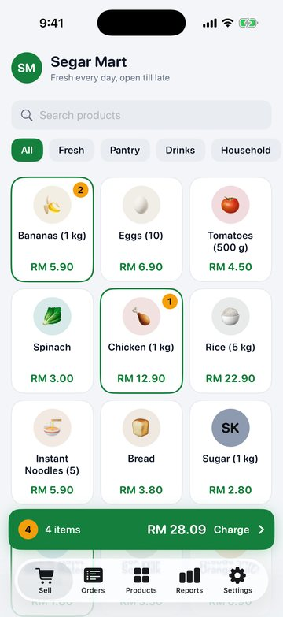 | 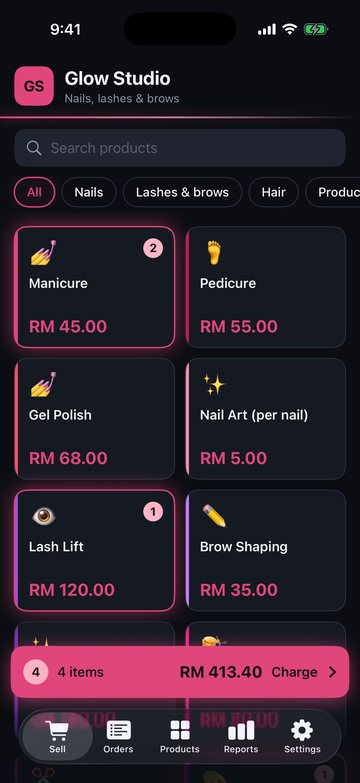 | 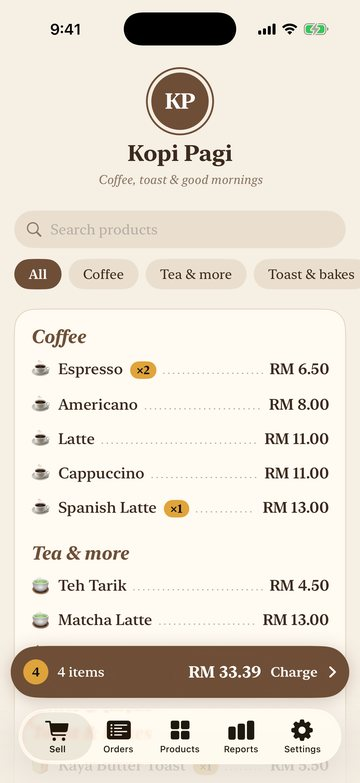 | 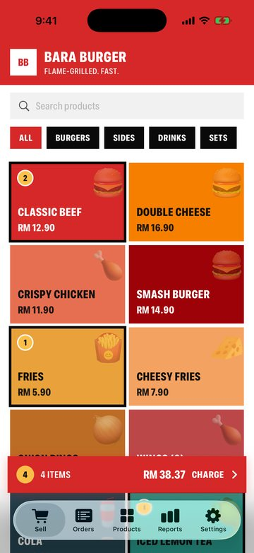 | 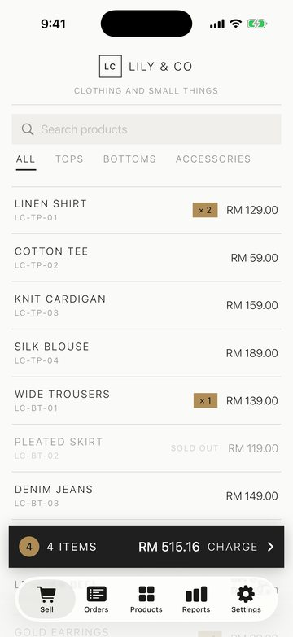 |
| 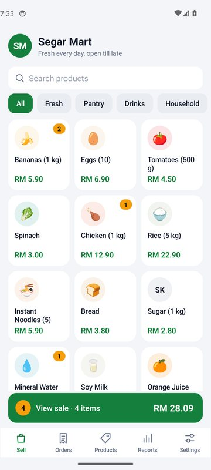 | 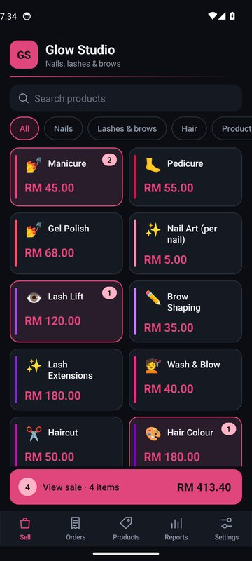 | 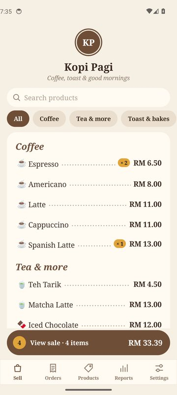 | 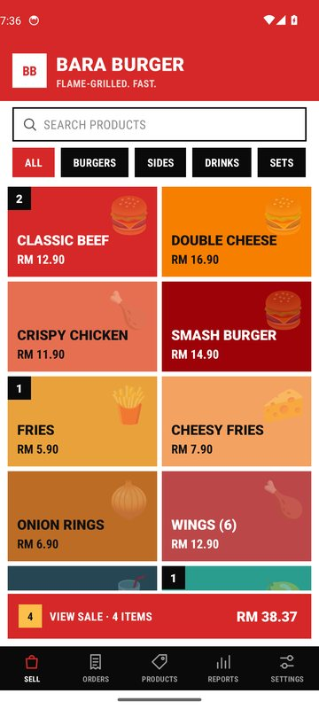 | 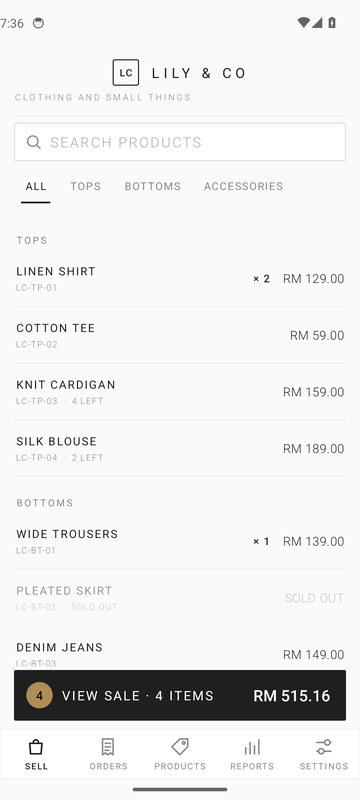 |

**Setup**: the owner brands the till in five steps, with a live preview in their own name and colours.

| Welcome | Logo & colours | Pick a design | Money & receipt | Finish |
|:-:|:-:|:-:|:-:|:-:|
| 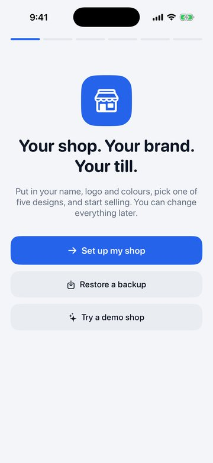 | 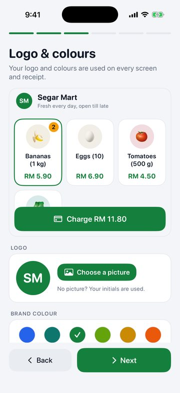 | 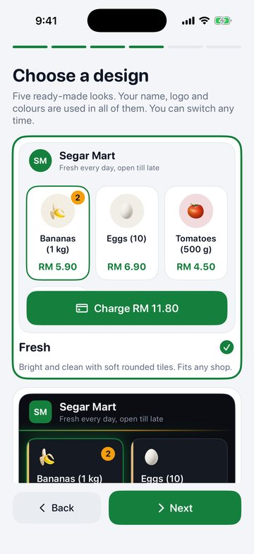 | 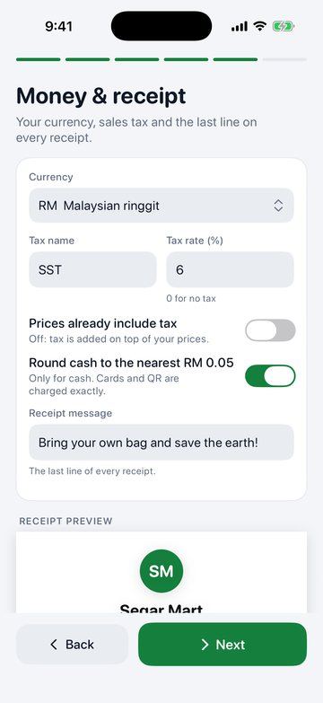 | 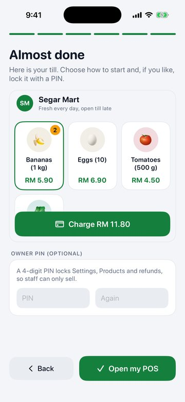 |

**Selling**

| Sale | Payment | Receipt | Reports | Settings |
|:-:|:-:|:-:|:-:|:-:|
| 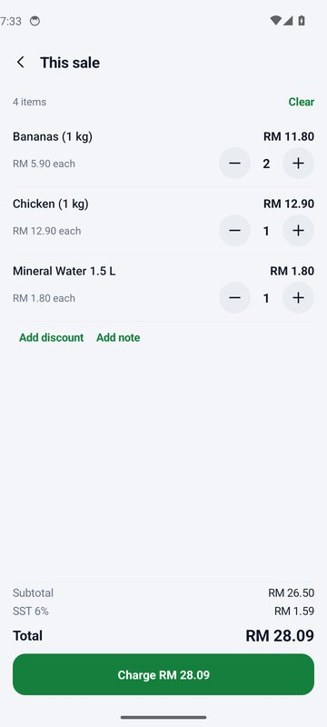 | 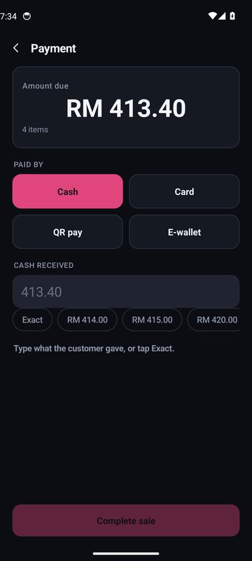 | 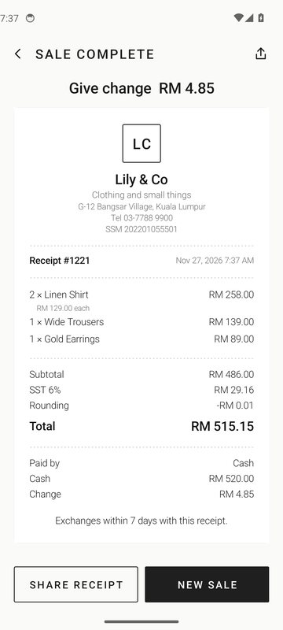 | 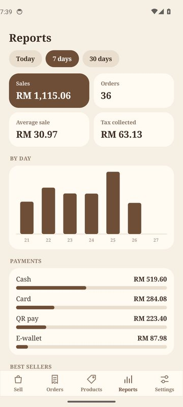 | 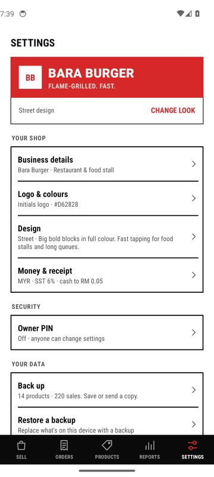 |
| 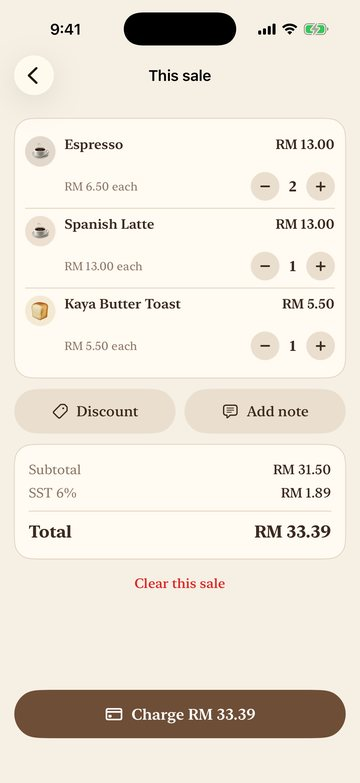 | 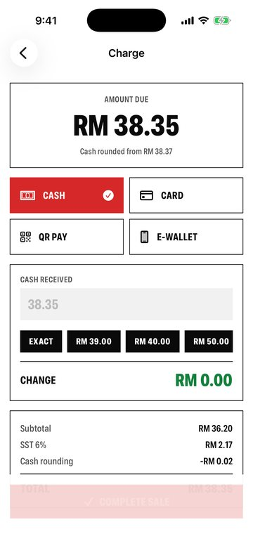 | 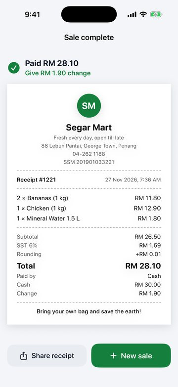 | 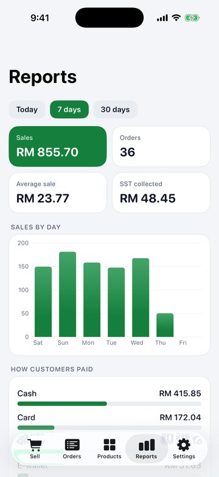 | 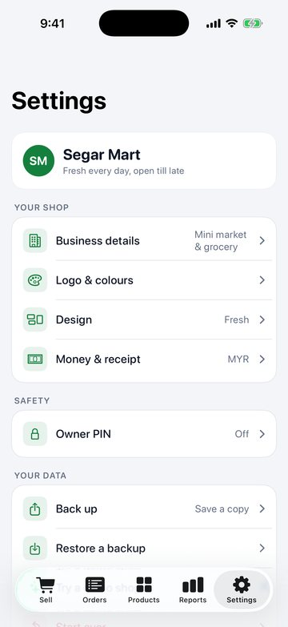 |

**Tablets** keep the sale open next to the products.

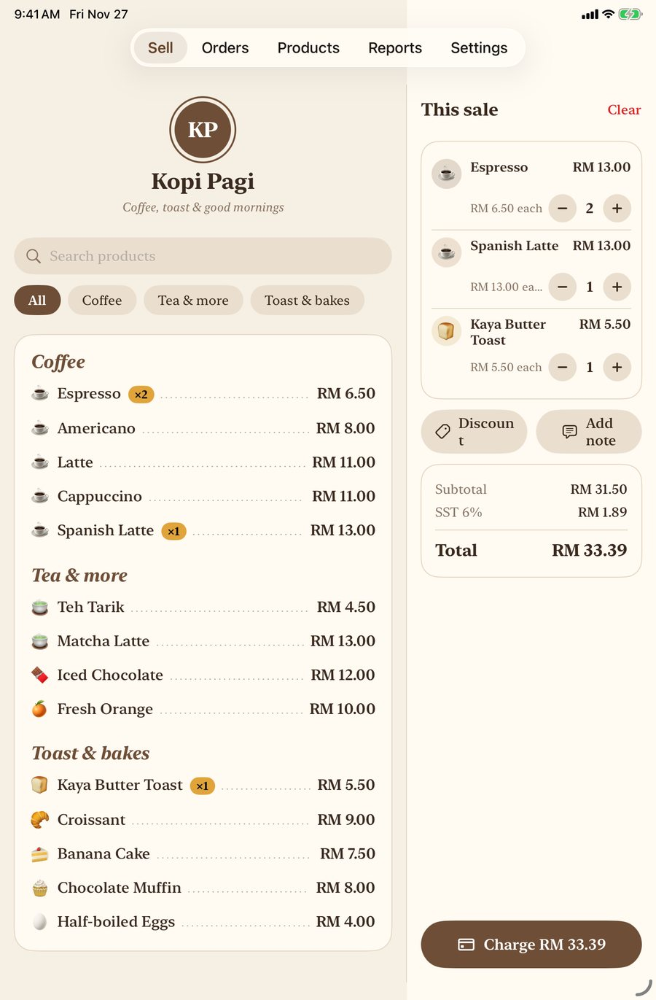 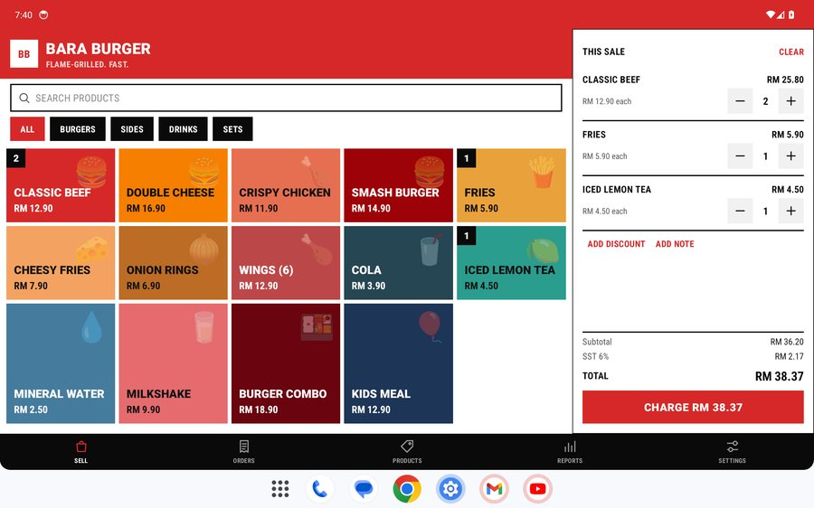


## The 5 design environments

| Design | Feel | Products shown as | Made for |
|---|---|---|---|
| **Fresh** | bright, clean, rounded | tiles with a soft round icon | any shop, mini markets |
| **Midnight** | dark screen, glowing brand colour | dark cards with a colour stripe | salons, bars, night service |
| **Café** | warm paper, serif letters | a printed menu with dotted lines to the price | cafés, bakeries |
| **Street** | bold, square, capitals | big blocks in full colour | food stalls, burgers, long queues |
| **Atelier** | quiet, minimal, fine lines | a spaced-out list with item codes | boutiques, studios |

Each design sets the layout, letters, corner shapes, header style, logo shape and category tabs.
The shop's own logo, brand colour and accent colour are laid on top, so the same design looks
different for every shop. The designs live in `whitelabel/app/designs.json`; change a colour
there and both apps follow.

## What the till does

- **Setup** (6 steps, with a live preview): welcome → business → logo & colours → design →
  money & receipt → finish (starter products, owner PIN). Or *Try a demo shop*, or
  *Restore a backup*.
- **Sell**: search, category tabs, tap to add, in-cart counts on each product, cart bar on
  phones and a cart panel on tablets.
- **Cart**: quantities, discount (amount or %), note, tax line, total.
- **Payment**: cash (quick amounts, change, 5-sen rounding for ringgit), card, QR pay, e-wallet.
- **Receipt**: logo, shop details, items, tax, rounding, change, footer. Shared as a picture.
- **Orders**: by day, search by receipt number, refunds (stock goes back).
- **Products**: categories, emoji or initials, colour, item code, stock count with *Sold out*.
- **Reports**: today / 7 days / 30 days, chart, payments by method, best sellers, refunds.
- **Settings**: edit any setup step, owner PIN (locks Products, Settings and refunds), backup and
  restore, demo shops, start over.
- 12 currencies (RM, S$, Rp, ฿, ₱, $, €, £ and more), tax added on top or included in prices.

## Rebranding the app itself (resellers)

The shop owner brands the till inside the app. To ship the **app** under another name (home
screen name, store listing, app id), edit one file used by both builds:

```
whitelabel/build.xcconfig
  APP_NAME = Shop POS               ← name under the icon
  APP_ID = com.r4xn.whitelabelpos   ← Android application id and iOS bundle id
  APP_VERSION = 1.0.0
  APP_BUILD = 1
```

Then swap the icons: `android/app/src/main/res/drawable/ic_launcher_foreground.xml` +
`values/colors.xml`, and `ios/WhiteLabelPOS/Assets.xcassets/AppIcon.appiconset`
(`ios/scripts/make-icon.swift` draws the default one). Nothing in the code names a shop.

To ship a version with a shop's look already chosen, or with your own starter products, edit
`whitelabel/app/catalogs.json` and `designs.json`.

## Building

Every push builds both apps on GitHub Actions and uploads them with screenshots of every
design (see the **Actions** tab, artifacts `WhiteLabelPOS-android` and `WhiteLabelPOS-ios`).
A tag like `v1.0.0` also attaches the Android app to a release.

**Android** (Android Studio or JDK 17):

```
cd android
./gradlew :app:testDebugUnitTest     # shared money / backup / report / demo checks
./gradlew :app:assembleDebug         # app/build/outputs/apk/debug/app-debug.apk
```

**iPhone & iPad** (Xcode 16+ on a Mac):

```
cd ios/POSCore && swift run core-check && cd ..    # same checks as Android
brew install xcodegen && xcodegen                  # makes WhiteLabelPOS.xcodeproj
open WhiteLabelPOS.xcodeproj                       # pick your team under Signing, then Run
```

Debug builds accept screenshot switches (`--es demo cafe --es design street --es open receipt`
on Android, `-demo cafe -design street -screen receipt` on iOS). See `whitelabel/SPEC.md`.

## How it fits together

```
whitelabel/            shared by both apps
  SPEC.md              how both apps behave: data file, money rules, designs, setup, screens
  build.xcconfig       reseller app name / id / version
  app/                 designs.json, catalogs.json, currencies.json (bundled into both apps)
  fixtures/            money cases + a sample backup that both test suites check
android/               Java app (programmatic views, no XML layouts, so designs switch live)
  app/src/main/java/com/r4xn/whitelabelpos/core/   rules, no Android code, unit tested
  app/src/main/java/com/r4xn/whitelabelpos/ui/     screens; Styles.java draws the 5 designs
ios/
  POSCore/             Swift package with the same rules + `core-check`
  WhiteLabelPOS/       SwiftUI app; Look.swift, Header.swift and ProductBoard.swift draw the designs
.github/workflows/     builds, tests and screenshots
```

The whole shop is one JSON document (`whitelabel/SPEC.md` section 2). Money is stored in sen /
cents, rates in basis points, so totals never drift. The demo shop's made-up sales come from the
same number sequence on both apps and are checked to match.
